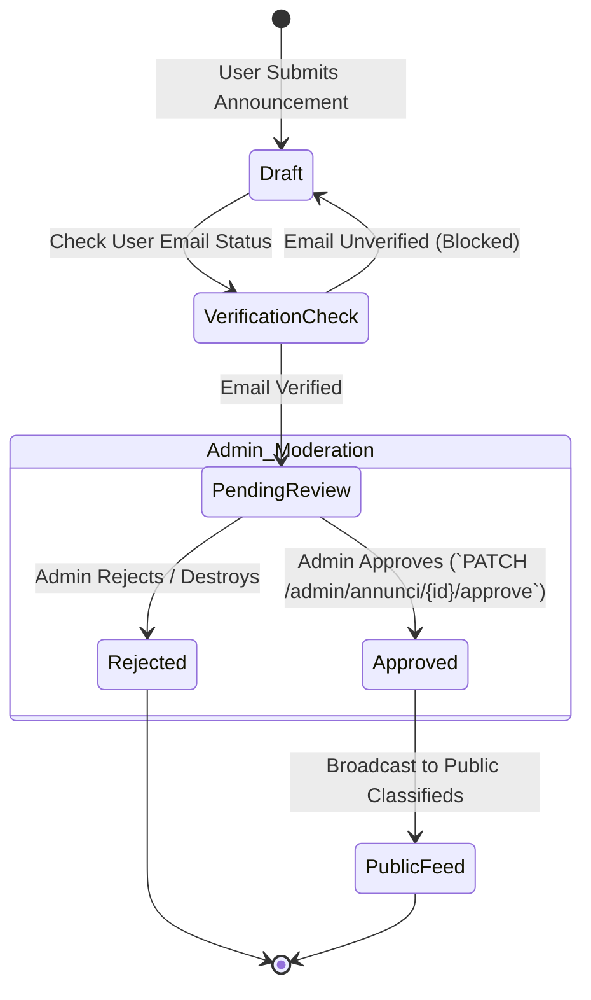

# Content Management & Moderated Community Announcements Portal

[](https://laravel.com)
[](https://www.php.net)
[]()
[](https://tailwindcss.com)
[](https://pestphp.com)
[]()

A clean, full-stack **Content Management & Moderated Classifieds Announcement Portal** engineered on **Laravel 12**, **Laravel Fortify**, **Tailwind CSS 4**, and **Vite**. Features headless user authentication with email verification safeguards, dual-tier article publishing, and a multi-stage editorial moderation approval pipeline for community announcements.

---

## 🏛️ Editorial Moderation Lifecycle



---

## 🌟 Core System Modules

### 1. 🔐 Hardened Authentication & Security (Laravel Fortify)
- **Headless Authentication:** Powered by `laravel/fortify` handling login, user registration, password resets, and session rate limits.
- **Mandatory Email Verification:** Protects against spam submissions via signed email verification tokens (`auth`, `verified` route middleware).
- **Two-Tier Role Separation:** Dedicated authorization middleware (`admin`) guarding editorial approval queues.

### 2. 📢 Community Announcement Board
- **Classifieds Feed:** Public discovery feed displaying verified community notices and classified listings.
- **Creator Dashboard (`/miei-annunci`):** Dedicated portal allowing registered users to monitor, update, and manage their personal submissions.

### 3. 🛡️ Administrative Moderation Queue (`/admin/annunci`)
- **Review Queue:** Centralized dashboard for staff to audit pending user submissions before public broadcasting.
- **One-Click Approval / Removal:** Instant PATCH action to approve listings or permanently soft-delete inappropriate entries.

### 4. 📰 Article & Publication CMS
- Direct CRUD interface (`ArticleController`) providing rich article authoring, updates, and categorized reading feeds.

---

## 🛠️ Technology Stack

| Layer | Technologies |
|---|---|
| **Core Framework** | Laravel 12.x, PHP 8.2 / 8.3 |
| **Authentication Engine**| Laravel Fortify v1.33 |
| **Frontend Styling** | Tailwind CSS v4, FontAwesome 6, Blade Components |
| **Asset Pipeline** | Vite 6 |
| **Database** | MySQL 8.0 / SQLite 3 |
| **Testing Suite** | Pest PHP v4, Pest Plugin Laravel, PHPUnit |
| **Code Quality** | Laravel Pint |

---

## 📂 Domain Layout

```
mini-cms/
├── app/
│   ├── Actions/Fortify/              # Password resets, user creation & updates
│   ├── Http/
│   │   ├── Controllers/
│   │   │   ├── AnnouncementController.php # Submission, user feed & admin moderation
│   │   │   ├── ArticleController.php      # CMS article publishing
│   │   │   └── HomeController.php         # Public showcase landing
│   │   └── Middleware/
│   │       └── AdminMiddleware.php        # Editorial authorization guard
│   └── Models/
│       ├── Announcement.php               # Moderated community notice model
│       ├── Article.php                    # Long-form article model
│       └── User.php                       # Fortify authenticated user
├── routes/
│   └── web.php                            # Verified auth & admin route definitions
└── composer.json
```

---

## ⚙️ Local Development & Quick Start

### Prerequisites
- **PHP:** `>= 8.2` (Extensions: `pdo_mysql`, `mbstring`, `openssl`, `curl`)
- **Composer:** `>= 2.5`
- **Node.js & NPM:** `Node 18+` / `NPM 9+`
- **Database:** MySQL 8.0+ or SQLite

### Setup Instructions

```bash
# 1. Clone repository
git clone https://github.com/alramim07/mini-cms.git
cd mini-cms

# 2. Install dependencies
composer install
npm install

# 3. Environment configuration
cp .env.example .env
php artisan key:generate

# 4. Database configuration in .env
# DB_CONNECTION=mysql
# DB_HOST=127.0.0.1
# DB_PORT=3306
# DB_DATABASE=mini_cms
# DB_USERNAME=root
# DB_PASSWORD=

# 5. Run database migrations & seed fixtures
php artisan migrate --seed

# 6. Build frontend assets & start local server
npm run build
php artisan serve
```

Access the portal at: **`http://127.0.0.1:8000`**

---

## 🧪 Testing & Code Quality

```bash
# Run automated Pest test suite
./vendor/bin/pest

# Run code style linter
./vendor/bin/pint --test
```

---

## 📄 License
This project is open-source software licensed under the [MIT License](LICENSE).
